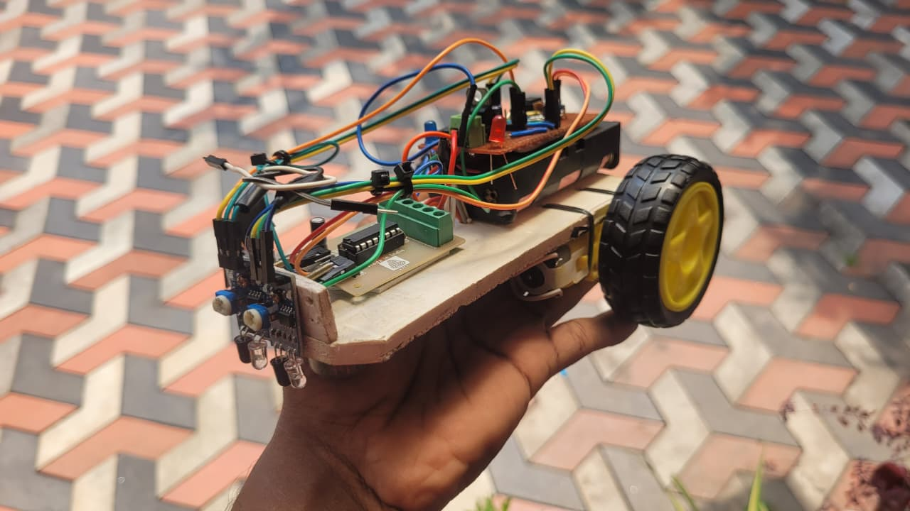
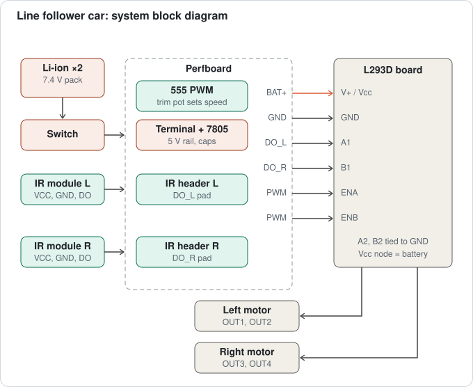
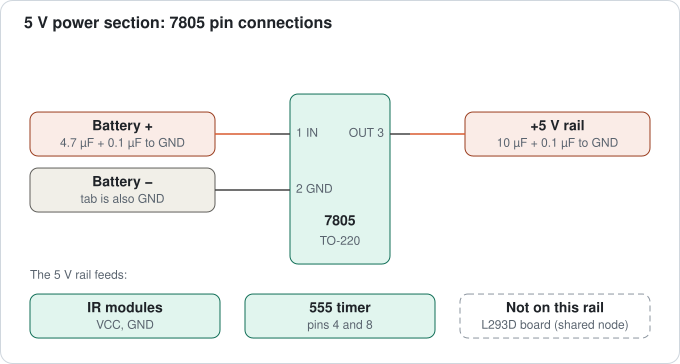
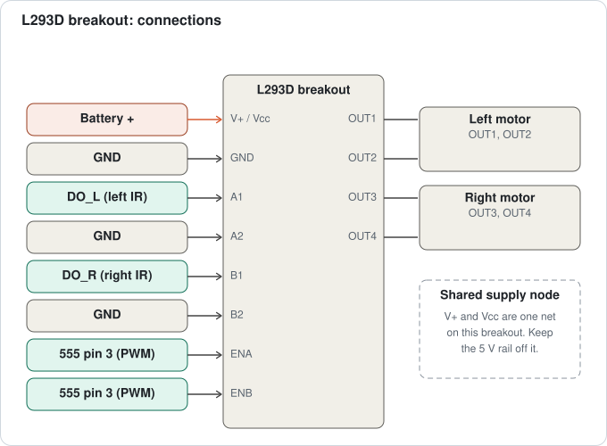
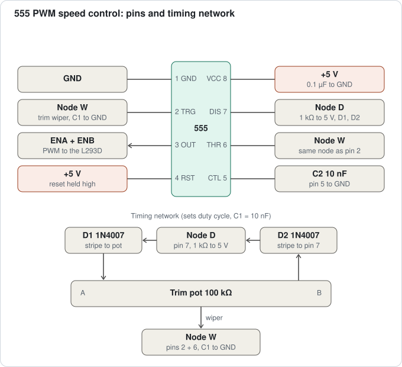
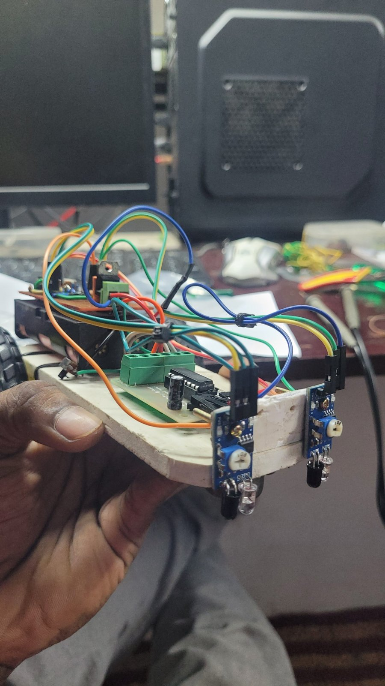
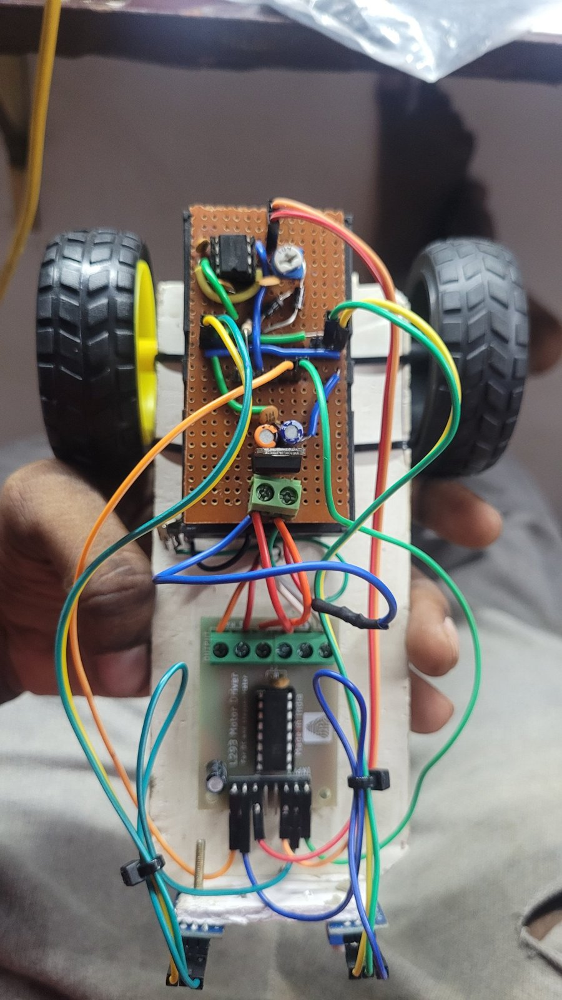
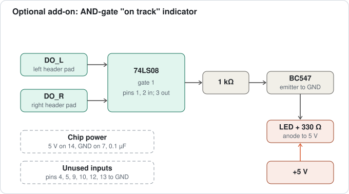

# Discrete Line Follower Car

A line-following robot built with **no microcontroller and no code**. IR sensor modules decide each wheel's on/off state through an L293D motor driver, and a 555 timer generates the PWM that sets the speed. Everything is soldered on a home-built perfboard.


<p align="center">
  
</p>

## Contents

- [How it works](#how-it-works)
- [Bill of materials](#bill-of-materials)
- [Circuit details](#circuit-details)
- [Photos](#photos)
- [Bring-up and testing](#bring-up-and-testing)
- [Tuning](#tuning)
- [Lessons learned](#lessons-learned)
- [Optional add-ons](#optional-add-ons)
- [Status and roadmap](#status-and-roadmap)
- [Repository layout](#repository-layout)

## How it works

Two IR modules sit on either side of a black line. Each module has an LM393 comparator on board, so its **DO** pin is already a clean digital signal: **HIGH over white, LOW over black**. Each DO signal goes straight to an input of the L293D, which only drives a motor when its two inputs differ.



### Steering logic

For each side, the sensor drives input 1 and input 2 is tied to GND:

| Surface under the sensor | DO | Input 1 (sensor) | Input 2 (GND) | Wheel |
|---|---|---|---|---|
| White floor | HIGH | HIGH | LOW | runs |
| Black line | LOW | LOW | LOW | stops (brake) |

With the line between the sensors, both wheels run while both sensors see white. If the car drifts, one sensor reaches the line, that wheel stops, and the other wheel pushes the car back toward the line. No inverter is needed.

### Speed control

A 555 runs as a **diode-steered astable**, which gives an adjustable duty cycle at a nearly constant frequency. Its output (pin 3) drives both L293D enable pins, so the motors see an average voltage proportional to the duty cycle. A trim pot is the speed knob.

## Bill of materials

| Qty | Part | Notes |
|---|---|---|
| 2 | 18650 Li-ion cells and holder | in series, 7.4 V nominal (8.4 V full) |
| 1 | Power switch | between the battery and the board |
| 1 | 7805 regulator (TO-220) | 5 V logic rail |
| 1 | NE555 and 8-pin socket | PWM generator |
| 1 | L293D motor-driver breakout | minimal board, see [lessons learned](#lessons-learned) |
| 2 | IR sensor modules | LM393 on board, pins VCC / GND / DO |
| 2 | BO motors with wheels | |
| 1 | 100 kΩ trim pot | marked 104 |
| 2 | 1N4007 diodes | D1, D2 (any small diode works) |
| 1 | 1 kΩ resistor | R1 |
| 2 | 10 nF capacitors | C1 (pins 2 and 6), C2 (pin 5) |
| 1 | 4.7 µF electrolytic | 7805 input, rated 16 V or more |
| 1 | 10 µF electrolytic | 7805 output |
| 3 | 0.1 µF ceramic (104) | 7805 input, 7805 output, 555 supply |
| 1 | Perfboard, screw terminal, pin headers | |
| – | Chassis plate, caster, Dupont wires, zip ties | |

Optional add-on parts: 74LS08, BC547, LED, 1 kΩ and 330 Ω resistors.

## Circuit details

### Power



- The battery goes through the switch to the perfboard screw terminal.
- The 7805 makes the 5 V rail for the IR modules and the 555.
- The **L293D board is powered from the battery terminal only**. It is not connected to the 5 V rail.
- A 7805 needs about 2 V of headroom, so the rail starts to sag when the pack drops below roughly 7 V. Stop and recharge before that.

### Motor driver



| Driver pin | Connects to |
|---|---|
| V+ / Vcc | battery + (direct from the screw terminal) |
| GND | common ground |
| A1 | left sensor DO |
| A2 | GND |
| B1 | right sensor DO |
| B2 | GND |
| ENA, ENB | 555 pin 3 (PWM) |
| OUT1, OUT2 | left motor |
| OUT3, OUT4 | right motor |

### 555 PWM generator



| 555 pin | Connects to |
|---|---|
| 1 | GND |
| 2 and 6 | tied together (Node W): trim pot wiper and C1 (10 nF) to GND |
| 3 | PWM out to ENA and ENB |
| 4 and 8 | +5 V (0.1 µF between 8 and 1) |
| 5 | C2 (10 nF) to GND |
| 7 | Node D: R1 (1 kΩ) to +5 V, D1 anode, D2 cathode |

D1's cathode (stripe) goes to one end of the trim pot, and D2's anode goes to the other end.

The capacitor charges through R1, D1, and one side of the pot, and discharges through the other side of the pot and D2, so:

- frequency ≈ 1.44 ÷ ((R1 + R_pot) × C1) ≈ 1.44 ÷ (101 kΩ × 10 nF) ≈ **1.4 kHz**
- duty cycle ≈ (R1 + R_A) ÷ (R1 + R_pot), roughly 1% to 99%

For a different trim pot, choose C1 to keep the frequency near 1.4 kHz:

| Trim pot | C1 |
|---|---|
| 100 kΩ | 10 nF |
| 47 kΩ | 22 nF |
| 20 kΩ | 47 nF |
| 10 kΩ | 100 nF |

Pin 3 is a square wave. The capacitor on pins 2 and 6 shows the rounded triangle-like ramp that sets the timing.

## Photos

<p align="center">
  
  
</p>

## Bring-up and testing

Bring the car up in stages, with the wheels off the ground:

1. **Before connecting anything:** check for solder bridges, and make sure there is no short between 5 V and GND (continuity beep).
2. **Power rail:** with only the regulator section connected, the 5 V output should read 4.9 to 5.1 V.
3. **Sensors and driver:** cover each sensor in turn. The matching wheel should stop over black and run over white.
4. **555 stage:** with the socket empty, pins 4 and 8 should read 5 V and pin 1 GND. Pins 2 and 6 should read about 4.3 to 4.5 V, which confirms D1's orientation. Then insert the 555 and check that turning the trim pot changes the wheel speed.
5. **On the track:** a strip of black tape on a light floor.

## Tuning

- **Speed:** a line follower reacts only as fast as its sensors. Turn the trim pot down until it holds the line, then creep it back up. Below about 40 to 50% duty the BO motors may stall.
- **Sensor spacing:** place the sensors just outside the edges of the line. Too wide and it overshoots, too narrow and it jitters.
- **Sensor height:** 3 to 8 mm above the floor, shaded from sunlight if possible.
- **Module pots:** adjust each module's pot so its output flips cleanly between the tape and the floor.

## Lessons learned

- **The L293D breakout has one shared supply node.** Its motor-supply terminal and its logic Vcc pin are the same net. Feeding 5 V into the logic pin while the motors were on the battery pulled the 5 V rail up to battery voltage. The fix: power the board from the battery only, and leave the 5 V rail disconnected from it.
- **Check your sensor polarity.** These modules output HIGH on white and LOW on black. Tying the unused driver inputs to **GND** (not 5 V) makes the wheel run on white and stop on black, with no inverter.
- **Never leave the enable pins floating.** They can pick up noise and make a motor cut out. They are driven by the 555.
- **Test each stage before soldering the next.** A perfboard is hard to change, so it pays to verify each section first.

## Optional add-ons

These are documented designs and are not part of the base build.

### AND-gate "on track" indicator

A 74LS08 AND gate lights an LED whenever **both sensors see white**. The LED is switched by a BC547, because the gate cannot source enough current to drive it directly.



### Other ideas

| Gate or chip | Output is HIGH when | Possible use |
|---|---|---|
| NAND (74LS00) | either sensor sees black | "correcting" indicator |
| OR (74LS32) | at least one sensor sees white | "moving" indicator |
| XOR (74LS86) | exactly one sensor sees black | turn indicator |
| NOR (74LS02) | both sensors see black | finish-line buzzer or lap counter |

- **Battery-low cutoff:** an LM393 comparator and a 74LS08 can block the PWM when the pack drops below about 7 V, to protect the Li-ion cells.
- **Reverse on black:** feeding A2 and B2 from inverted copies of the sensor signals makes the inner wheel reverse for sharper corners.
- **Home-made sensors:** build the sensor stage from an IR LED, a photodiode, and an LM393 instead of the ready-made modules.

## Status and roadmap

- [x] Line following on a straight track
- [x] PWM speed control with the 555
- [ ] Corner and curve tuning
- [ ] AND-gate indicator on the car
- [ ] Battery-low cutoff
- [ ] Reverse on black for sharp corners

## Repository layout

```
.
├── README.md
├── LICENSE
├── docs/
│   ├── block-diagram.svg
│   ├── power-7805.svg
│   ├── driver-l293d.svg
│   ├── pwm-555.svg
│   └── and-indicator.svg
└── images/
    ├── car-side.jpg
    ├── car-front-sensors.jpg
    └── car-top.jpg
```

## License

Released under the [MIT License](LICENSE).

Built by Max (Gautham Dhanush D).
